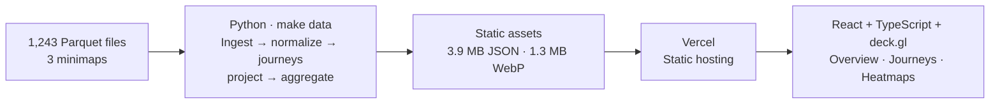

# Architecture: LILA BLACK Player Journey Viewer (One Page)

**Goal:** Turn five days of LILA BLACK telemetry into reliable, explorable maps for level designers. [Live app](https://lila-black-journey-viewer.vercel.app/) · [Technical report](docs/reports/TECHNICAL_REPORT.md) · [Edge cases](docs/reports/EDGE_CASES.md) · [Assumptions & evidence](docs/evidence/README.md)

## 1. System design

**Why this architecture?** The ~8 MB source dataset is fixed and the required queries are known. Python (pandas, pyarrow, NumPy, Pillow) validates and precomputes the data once; Vercel serves committed files without a backend. React/Vite provides the UI, deck.gl renders paths and heatmaps in one WebGL view, and Zustand/React Router keep filters and playback shareable via the URL. The browser loads `index.json` first, then match or heatmap files on demand. Journeys supports map/date/match filters, distinct human/bot paths and event markers, and timeline playback.

## 2. Coordinate mapping: the critical step

1. **Normalize world coordinates in Python:** `u = (x − origin_x) / scale`, `v = (z − origin_z) / scale`. World `y` is elevation, not a top-down map axis.
2. **Store UV, not pixels.** Draw with `pixel_x = u × width`, `pixel_y = (1 − v) × height`: the vertical flip corrects the image origin, and separate width/height preserve GrandRift's **2160 × 2158** aspect ratio. UV stays aligned when large minimaps are resized to WebP.
3. **Use one drawing space.** deck.gl places the image and every overlay using the same UV-derived coordinates, preventing relative drift during zoom, pan and playback.

**Worked check:** AmbroseValley world `(−301.45, −355.55)` → UV `(0.0762, 0.1305)` → approximately **(312, 3562)** on its 4096-pixel WebP; without the flip, Y would be about **535**. Formula/corner tests and round-trip checks pass (maximum **0.071 world units** of rounding error); **99.69–100%** of independently checked samples land on map content. **Limit:** no surveyed landmarks exist, so this supports alignment, not exact ground truth. [Validation evidence](docs/evidence/coordinates/grandrift_validation.md)

## 3. Assumptions that affect correctness

| Ambiguity | Implemented handling |
|---|---|
| `ts` declared milliseconds; `event` stored as bytes | Treat values as **Unix seconds**; decode events as UTF-8 and reject unknown types. |
| Numeric IDs do not always identify bots | `BotPosition` ⇒ bot; **17** conflicting journeys counted as human but flagged `id_mismatch` (not proven human-operated). |
| Repeated records may be genuine events | Skip one identical file and remove **190** rows from three proven doubled journeys; preserve other same-second loot. |
| Event position belongs to the file owner | A kill marks the **killer's** position; a death marks the **victim's** position. Ambiguous `Kill`/`Killed` pairs remain flagged. |
| Missing positions and incomplete match coverage | Break paths at gaps **>30 s**; label activity **recorded**, not complete. No extraction event is inferred as fact. |

**Open caveat:** The current traffic model traces short straight-line steps and omits longer gaps; an independent audit suggests some gaps represent standing still, making per-cell time estimates uncertain. [Audit details](docs/evidence/README.md)

## 4. Major trade-offs

| Considered | Chosen and why |
|---|---|
| FastAPI/DuckDB backend vs static files | **Static:** fewer runtime failure points; revisit for live or much larger data. |
| Browser Parquet parsing vs Python preprocessing | **Python:** predictable loading, reproducible generated assets. |
| Pixel coordinates vs UV | **UV in the pipeline:** one tested transform; image-size independent. |
| `TripsLayer` vs cutting paths at playback time `t` | **Cut paths:** same styling as the static view, straightforward to test at observed match sizes. |
| Complex resampling-based hotspots vs simple guards | **≥5 matches, ≤50% from any one match, top 6:** explainable, though grid placement can affect results. |

**Verification (24 Oct 2026):** 130 pipeline tests and 476 web tests passed; repeated builds produced byte-identical assets. Independent audits and known limitations are documented in the [technical report](docs/reports/TECHNICAL_REPORT.md). Game-design findings are kept separately in [INSIGHTS.md](INSIGHTS.md).
