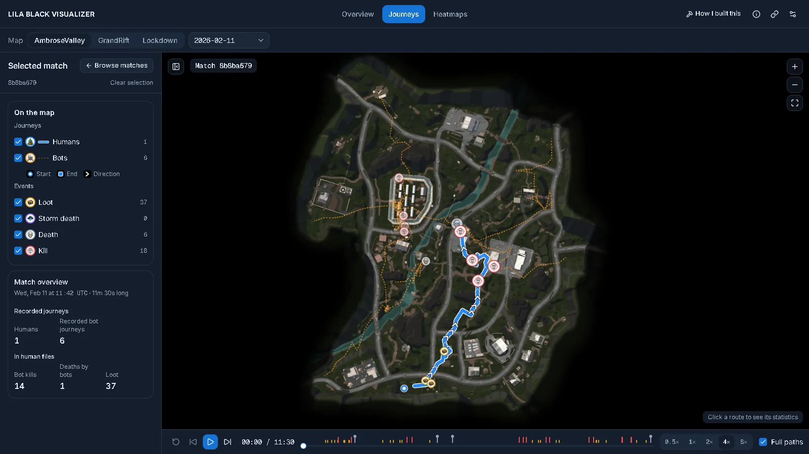
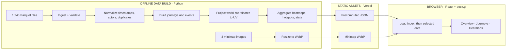
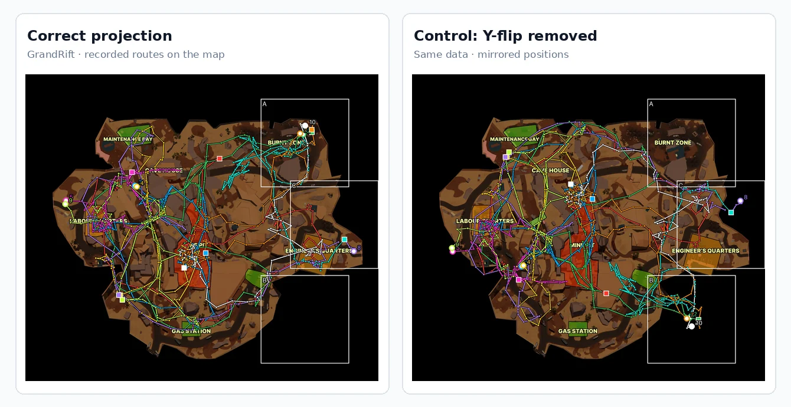
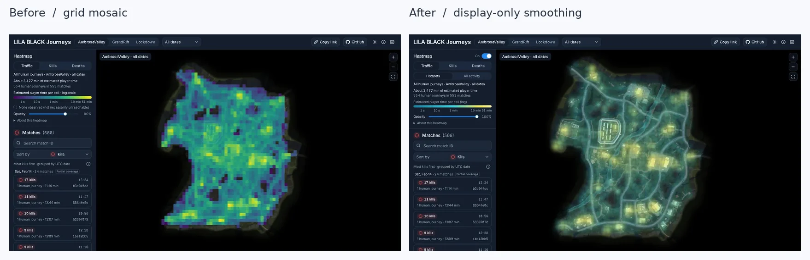

<div align="center">

# LILA BLACK Player Journey Viewer

**Turning imperfect game telemetry into an explorable map for level designers.**

A browser-based tool for investigating player routes, fights, loot, storm deaths, and spatial activity across **AmbroseValley**, **GrandRift**, and **Lockdown**.

[**Open the live application**](https://lila-black-journey-viewer.vercel.app/) · [**Explore the architecture**](ARCHITECTURE.md) · [**Read the build story**](docs/reports/ARTICLE.md) · [**Audit the evidence**](docs/evidence/README.md)

`React` · `TypeScript` · `deck.gl` · `Python` · `Parquet` · `Vercel`

</div>



*The Journeys page: match `8b8ba679` on AmbroseValley (11 February), with the human route in solid blue, six bots in dashed amber, kill, death and loot markers, and the playback bar with event ticks (captured 25 October 2026).*

## At a glance

| Raw data | Processed dataset | Product | Deployment |
|:--|:--|:--|:--|
| **1,243** Parquet files + **3** minimaps | **796** matches · **88,653** retained rows | **3** exploration views | **Static** React app · no runtime backend |

The objective was not merely to plot points. The supplied telemetry contains misleading timestamp metadata, ambiguous actor IDs, duplicated journeys, sparse movement samples, and incomplete match coverage. The viewer needs to make these limitations explicit while still giving designers a useful picture of **what was actually recorded**. Here, a **journey** means one recorded actor within one match; it is not the same as a whole match.

### Jump to

[Features](#what-you-can-do) · [System design](#system-design) · [Coordinate mapping](#coordinate-mapping-the-tricky-part) · [Data correctness](#handling-imperfect-data) · [Run locally](#run-it-locally) · [Verification](#testing-and-verification) · [Deploy](#deployment) · [Documentation](#documentation)

---

## What you can do

| View | What a level designer can investigate |
|:--|:--|
| **Overview** · `/stats` | Compare recorded activity, journey lengths, kills, deaths, and other metrics across the three maps. |
| **Journeys** · `/journeys` | Open a recorded match, distinguish human and bot routes, inspect events, and replay movement on the actual minimap. |
| **Heatmaps** · `/heatmaps` | Explore estimated traffic and recorded kill/death concentrations by map and date, with labelled hotspot regions. |

### A 90-second walkthrough

1. **Start in Overview:** compare the three maps and select one to investigate.
2. **Open Journeys:** choose a match, inspect the event markers, and press Play to see routes unfold.
3. **Switch to Heatmaps:** compare Traffic, Kills, and Deaths and inspect a highlighted region.
4. **Copy the URL:** reopen it to return to the same selected view.

### Technology stack

| Layer | Technologies |
|:--|:--|
| **Data preparation** | Python 3.11+, pandas, PyArrow, NumPy, Pillow; `uv` for dependency management |
| **Frontend** | React 19, TypeScript, Vite, Tailwind CSS v4, shadcn/ui |
| **Visualizations** | deck.gl / WebGL for the map; Recharts for overview charts |
| **State and routing** | Zustand, React Router, URL synchronization |
| **Validation** | pytest, Vitest, TypeScript build checks, oxlint |
| **Hosting** | Vercel serving static files; no runtime API or environment variables |

The viewer also supports:

- **Match playback:** a single match-relative clock, scrubbing, and playback speeds from 0.5× to 8×.
- **Clear visual encoding:** solid blue human paths, dashed amber bot paths, and distinct event markers.
- **Shareable deep links:** map, date, match, page, and relevant playback/layer state are reflected in the URL.
- **Honest labels:** sample sizes, partial dates, recorded activity, and uncertainties are shown instead of implied completeness.

> **Important:** This is a record of sampled telemetry, **not a complete record of every actor in a match**. Of 796 matches, 743 contain only one recorded actor file. A blank region means *no recorded activity*, not necessarily *no player activity*.

## System design

The system separates expensive, testable data interpretation from lightweight browser rendering. All raw-data processing happens **before deployment**; visitors fetch the precomputed files they need.



### Why this architecture?

| Decision | Reason | When to reconsider |
|:--|:--|:--|
| **Python pipeline, not Parquet parsing in the browser** | Decode, clean, and validate 1,243 files once rather than on every visit. | Raw data must be queried dynamically. |
| **Precomputed JSON, not FastAPI + DuckDB** | The dataset is fixed and the required queries are known; a backend adds unnecessary runtime dependencies. | Data becomes live, significantly larger, or user-specific. |
| **One projection function and UV output** | Paths, markers, playback, and heatmaps all share the same map coordinates. | Calibration or rendering requirements fundamentally change. |
| **deck.gl, not geographic tile tooling** | WebGL layers draw a game minimap, routes, events, and heatmaps in one zoomable/pannable view. | Rendering requirements change enough to justify another engine. |

### What the browser receives

| Asset | Contents | When loaded |
|:--|:--|:--|
| `index.json` | Maps, dates, match metadata, coverage information | Initial load |
| `matches/<id>.json` | An actor's path segments, event times, coordinates, and flags | When a match is selected |
| `heatmaps/<map>.json` | Sparse 64×64 traffic/kill/death grids | When exploring heatmaps |
| `zones/<map>.json` | 16×16 region values and qualified hotspots | When exploring heatmaps |
| `stats.json` | Precomputed map/date statistics | Overview |
| `maps/*.webp` | Resized minimap artwork | As required by the active map |

The pipeline writes about **3.9 MB of JSON** and **1.3 MB of WebP** in total; these are *all generated assets*, **not** the amount every visitor downloads at startup. Files are committed under `web/public/` and served statically.

**More detail:** [ARCHITECTURE.md](ARCHITECTURE.md) explains each stage and the alternatives considered. [TECHNICAL_REPORT.md](docs/reports/TECHNICAL_REPORT.md) covers the complete data contract.

📄 **[Data flow, from parquet to screen (PDF, 7 pages)](web/public/case-study/data-flow.pdf)**: the system diagram, where every row goes during cleaning, one kill followed from its parquet row to the pixel, and how heatmaps are built.

## Coordinate mapping: the tricky part

Telemetry positions are expressed in game-world `(x, y, z)`, but the minimaps are images. The original data README provided a useful projection formula while incorrectly describing all minimaps as 1024×1024 pixels. In reality, the images have different dimensions, and GrandRift is not exactly square.

The solution is to store **normalized UV coordinates**, not image pixels:

```text
u = (world_x - origin_x) / map_scale
v = (world_z - origin_z) / map_scale

pixel_x = u × image_width
pixel_y = (1 - v) × image_height
```

- World **`y` is elevation** and is not needed for a top-down map.
- `1 - v` **flips the vertical axis**: images increase downward; world `z` increases upward.
- Separate width and height preserve **GrandRift's 2160×2158** aspect ratio.
- UV positions remain aligned when large minimaps are resized to **at most 4096 px** for the web.

**Worked example:** An AmbroseValley world point `(−301.45, −355.55)` projects to approximately `(u=0.0762, v=0.1305)` and **(312, 3562) pixels** on the 4096×4096 WebP. Without the vertical flip, the y-coordinate would be about **535**, placing the point in the wrong part of the map.



*Actual validation overlays: production projection vs. the same journeys with the vertical flip removed.*

**How I checked it:** production math tests for corners, centres, and axis directions; visually reviewed overlays; reverse-mapping all exported path positions with at most **≈0.071 world units** of rounding error; and an independent map-content comparison that placed **99.69–100%** of tested positions on map content.

**Limit:** there are no authoritative landmark/world-coordinate pairs. These checks establish strong consistency and plausible alignment, **not pixel-perfect ground truth**. See [coordinate evidence](docs/evidence/coordinates/grandrift_validation.md) and [reverse-mapping evidence](docs/evidence/coordinates/reverse_mapping_validation.md).

📄 **[Coordinate mapping, step by step (PDF, 7 pages)](web/public/case-study/coordinate-mapping.pdf)**: the four coordinate systems, each map's calibration, two positions worked by hand, every path drawn with the real mapping and with two wrong ones, and the round-trip check.

## Handling imperfect data

Several rules are deliberately conservative. The aim is to render observed events without turning ambiguity into a false claim.

| Issue found | Handling in the viewer |
|:--|:--|
| Timestamp column declares milliseconds but values behave as **Unix seconds** | Convert to seconds; use a shared match-relative playback clock. |
| `event` is stored as bytes | Decode UTF-8; stop the build on an unexpected event type. |
| **17** numeric-ID journeys behave like player clients | Classify by `BotPosition` events; count them as human journeys while retaining an `id_mismatch` flag. A human operator is **not proven**. |
| One repeated file and three journeys duplicated end-to-end | Read the identical file once; remove **190 proven copied rows**. Preserve ordinary same-second repeated events. |
| Some events appear after a recorded death | Remove **173 later position samples** from paths/playback, but keep and flag two late `BotKill` events. |
| Event coordinates describe the **file owner** | A kill marker shows the killer's position; a death marker shows the victim's position. |
| `Kill` and `Killed` occur as three ambiguous same-second pairs | Keep both with flags; exclude the paired `Kill` from counted kills; do not label the cause a self-kill. |
| No extraction event exists | End a journey at its **last recorded position**, never label it a confirmed extraction. |

### Movement gaps and traffic estimates

The implemented path/playback rule **splits at gaps over 30 seconds** and traces traffic along shorter sampled steps. This is a rendering decision, **not proof of a player's actual route or time spent standing**. An independent audit found evidence that longer gaps often represent stationary periods; the existing traffic model omits roughly **3.9–4.3%** of estimated human time and can undercount some cells. Global traffic patterns were relatively stable across sensitivity checks, but local values remain **contested**.

[All 30 recorded edge cases](docs/reports/EDGE_CASES.md) · [Assumptions A1–A22 and supporting evidence](docs/evidence/README.md)

📄 **[Assumptions and evidence audit (PDF, 11 pages)](web/public/case-study/assumptions-evidence-audit.pdf)**: 22 data and display assumptions, each with its evidence; two are marked contested (the traffic model, A11, and the map score, A20).

### Making heatmaps readable without changing the counts

The first heatmap looked like a solid 64×64 mosaic. The later design paints each cell as a soft bump for display only; **neighbouring grid values are not summed to create artificial peaks**, and hover values come from the underlying grid.



Hotspots use **16×16 regions** rather than fragile individual cells: at least **five contributing matches**, no single match supplying more than **50%**, and at most **six** regions shown per layer. Kill/death cells use fixed count classes: **1 / 2–3 / 4–9 / 10+**.

## Game-design insights

[`INSIGHTS.md`](INSIGHTS.md) has three findings, each tested against chance, other grid sizes and both halves of the dates; leads that failed were left out:

1. **Players start and finish in a handful of places:** the top 6 of 400 grid cells hold 68–80 % of starts and survivors' ends on AmbroseValley and Lockdown.
2. **A quarter of Lockdown's inland area is never walked on**, twice AmbroseValley's share at the same number of journeys.
3. **On Lockdown, one in six players dies before picking anything up**, three times AmbroseValley's rate.

Every figure is reproduced by `pipeline/tools/insight_stats.py` on the cleaned pipeline output.

The absence of a logged extraction event, incomplete player coverage, and estimated traffic all limit causal interpretations.

---

## Run it locally

### Requirements

- **Node.js 22.x** recommended (the Vite toolchain also specifies supported newer Node 20 releases).
- **npm** (installed with Node).
- **Python 3.11+** and [**uv**](https://docs.astral.sh/uv/) if rebuilding the data pipeline.
- **`make`** for the documented shortcut commands. On Windows, use an environment with `make` or run the corresponding commands directly.

### Option A: Run the website using the committed data

You **do not need the original Parquet files** just to run the frontend. The cleaned JSON and minimaps are already committed.

```bash
git clone https://github.com/Shashidharahegde/lila-black-journey-viewer.git
cd lila-black-journey-viewer
cd web
npm ci
npm run dev
```

Open the local address printed by Vite (typically `http://localhost:5173`).

**From the repository root**, `make setup` installs both Python and web dependencies, and `make web` launches the frontend. Use those when you also plan to work on the pipeline.

### Option B: Rebuild from the original data

The raw archive is not part of the repository. Obtain `player_data.zip` separately and extract it so the project contains:

```text
data/raw/player_data/
  February_10/
  February_11/
  ...
  minimaps/
```

The important check is that `data/raw/player_data/February_10/` exists; keep the archive's original directory structure.

```bash
make setup             # uv sync + npm ci
make data              # regenerates JSON, WebP and build_report.json
make test              # Python pipeline tests
make web               # starts the React development server
```

`make data` writes the generated web assets to `web/public/data/` and `web/public/maps/`, plus a build report under `docs/evidence/`. The pipeline is designed so **identical inputs produce byte-identical output**. Its runtime varies with the machine; the previously documented “~45 seconds” should not be treated as a benchmark.

<details>
<summary><strong>Without uv / Make</strong></summary>

The repository includes `pipeline/requirements.txt`, exported from `uv.lock`. After changing Python dependencies, run `make requirements` to regenerate it.

```bash
cd pipeline
python -m pip install -r requirements.txt
python -m pip install -e .
python -m lila_pipeline.build
python -m pytest

# In a separate terminal, from the repository root:
cd web
npm ci
npm run dev
```

The pipeline rebuild still requires the original raw data in `data/raw/`.

</details>

## Testing and verification

From the root of the repository:

```bash
make test           # pipeline: pytest
make check-ids      # scan trackable files for raw player IDs and key-like secrets

cd web
npm test            # Vitest
npm run lint        # oxlint
npm run build       # TypeScript check + production Vite build
```

**Documented checks (24 October 2026; not rerun for this README):**

| Verification | Recorded result |
|:--|:--|
| Pipeline tests | **130 passed** |
| Web tests | **476 passed** |
| Determinism | Byte-identical generated output on rebuild |
| Cross-file / browser figures | **8,011 / 815** checks, **0** reported mismatches |
| Independent forensic audit | Reproduced the audited export's match files, grids, and statistics |

Tests confirm implementation behavior; independent evidence is required to challenge the *assumptions*. The cited forensic reproduction predates the last actor-classification and hotspot rule changes, so it should not be described as an independent audit of those later rules.

[Technical report](docs/reports/TECHNICAL_REPORT.md) · [Forensic audit](docs/audits/forensic/FORENSIC_AUDIT_REPORT.md)

## Project structure

```text
.
├── README.md                    # Start here
├── ARCHITECTURE.md              # Visual system design and engineering trade-offs
├── INSIGHTS.md                  # Three verified game-design findings
├── Makefile                     # Setup, data, tests and dev-server shortcuts
├── data/raw/                    # Local original data (gitignored; not on GitHub)
├── pipeline/                    # Python ingest → normalize → project → export
│   ├── src/lila_pipeline/
│   ├── tests/
│   └── tools/
├── web/                         # React / TypeScript application
│   ├── src/
│   ├── public/data/             # Generated and committed JSON
│   ├── public/maps/             # Generated and committed WebP
│   └── vercel.json
└── docs/                        # Specs, reports, audits and evidence
    ├── README.md
    ├── reports/
    ├── evidence/
    ├── audits/
    └── specs/
```

## Deployment

Deployment uses **Vercel as a static host**. The Python pipeline runs separately and is **not executed during Vercel builds**. The generated data and minimaps are committed to the repository.

| Vercel setting | Value |
|:--|:--|
| Root directory | `web` |
| Framework preset | `Vite` |
| Install command | `npm install` (default; local setup uses `npm ci`) |
| Build command | `npm run build` |
| Output directory | `dist` |
| Node.js | Compatible 22.x runtime |
| Environment variables | **None** |

`web/vercel.json` rewrites application routes to `index.html` while leaving `/assets/`, `/data/`, and `/maps/` as static resources. Cache headers distinguish hashed code assets (one year), minimaps (one week), and data files (five minutes with revalidation). The project is configured to deploy changes pushed to the connected production branch.

**Production:** https://lila-black-journey-viewer.vercel.app/

## Known limitations

- **Recorded does not mean complete.** Most matches contain one recorded actor file; unseen opponents cannot be inferred from absent logs.
- **No confirmed extraction outcome.** A journey ending alive could be an extraction, disconnect, or incomplete recording.
- **Traffic is estimated.** Its current allocation of time across long gaps is contested; avoid reading exact cell intensities as ground truth.
- **Coordinate alignment is strongly checked, not ground-truthed.** The audit's map-art registration estimate is about ±10 world units.
- **Actor classification is reversible but uncertain.** The 17 numeric-ID/player-client mismatches are counted as human journeys and flagged.
- **Pseudonyms are not robust anonymization.** Short unsalted hashes remove raw IDs from output but may be reversible for small numeric ID spaces.
- **The relative map score is not an objective quality ranking.** Interpret it as a constructed comparison index, not a determination that one map is better designed.

## Documentation

| If you want to… | Read |
|:--|:--|
| Understand the design decisions | [**Architecture**](ARCHITECTURE.md) |
| Follow the development journey | [**Build story**](docs/reports/ARTICLE.md) |
| Inspect implementation details and tests | [**Technical report**](docs/reports/TECHNICAL_REPORT.md) |
| Check a specific data edge case | [**Edge-case register**](docs/reports/EDGE_CASES.md) |
| Challenge the evidence for an assumption | [**Assumptions and evidence**](docs/evidence/README.md) |
| Examine independently reproduced results | [**Forensic audit**](docs/audits/forensic/FORENSIC_AUDIT_REPORT.md) |
| Read the game-design findings | [**Insights**](INSIGHTS.md) |
| Find feature specs, reviews and remaining files | [**Full documentation index**](docs/README.md) |

---

<div align="center">

**Explore the tool:** [Live demo](https://lila-black-journey-viewer.vercel.app/) · [How it works](ARCHITECTURE.md) · [Audit the assumptions](docs/evidence/README.md)

*Engineering principle: show what the evidence supports, and make uncertain decisions visible.*

</div>
