# Assumptions and the evidence behind them

Every assumption the LILA BLACK Journey Viewer makes about the data, with the evidence for it underneath. This page is the entry point to `docs/evidence/`; the reference write-up is [TECHNICAL_REPORT.md](../reports/TECHNICAL_REPORT.md) and the build story is [ARTICLE.md](../reports/ARTICLE.md). (`ASSUMPTIONS_AND_EVIDENCE.pdf` beside it is an export of an earlier copy of this page.)
Everything here is taken from the files in `docs/evidence/`; no number was added that isn't in one of them. Each section links to its source.

**Status labels**
- **Current**: what the pipeline and site do today.
- **Superseded**: the evidence still stands, but the decision built on it changed later (the newer rule is given).
- **Contested**: the forensic audit found that the evidence doesn't fully support it. It is still in use, and the decision is S's to make.

**Read this first: some evidence files are older than the current rules.**
- `event_forensics/*.md` and the audit say the 17 numeric-ID journeys are `unknown`. Since 2026-10-24 they are counted as **human** and flagged `id_mismatch` (the CSV, `forensics_summary.json` and `build_report.json` were regenerated; the `.md` pages were not).
- `spatial_analysis/`, `zone_sensitivity.md`, `interpretation_layer/` and `tabs_and_outlines/` show the earlier hotspot rule ("consistent concentrations"). It was replaced on 2026-10-24 (see A17).
- Screenshots in `heatmap_review/`, `interpretation_layer/` and `tabs_and_outlines/` show earlier versions of the UI.

---

## Contents
**Reading the raw data**
- A1 `ts` holds Unix seconds
- A2 The event column is UTF-8 text
- A3 The README coordinate formula is correct, with the y-flip
- A4 The browser's reverse mapping (hover) is the exact inverse
- A5 Duplicates: one file read once, three doubled journeys halved, nothing else removed

**What the rows mean**
- A6 Actors are classified by behaviour, not by ID
- A7 An event's position is the file owner's position
- A8 `Kill`/`Killed` pairs: keep both, claim no cause
- A9 Positions after a death are dropped
- A10 A match's date is the UTC date of its first event
- A11 Gaps over 30 s break paths, and traffic is traced along the line (**contested**)
- A12 Bot journeys are recorded in only some matches
- A13 Rates are per recorded human journey
- A14 Storm deaths stay in the Deaths layer
- A15 Ending alive is not proof of extraction

**Heatmaps and hotspots**
- A16 Single 64 × 64 cells aren't stable; 16 × 16 regions are used for hotspots
- A17 Hotspot rule: ≥ 5 matches, no match over 50 %, at most 6 per layer
- A18 Kills and deaths are coloured by count classes
- A19 Heatmaps are a painted picture, not a cell mosaic

**Statistics and the whole system**
- A20 The map performance score (**contested**)
- A21 The site shows exactly the numbers the pipeline produced
- A22 The pipeline is mathematically correct and reproducible

Appendix: open points from the audit · index of every evidence file

---

## A1. `ts` holds Unix seconds, not milliseconds
**Status:** Current. **Assumption:** `ts` is stored as `timestamp[ms]` but holds Unix epoch **seconds**. Match time = `ts` − the earliest `ts` in the match.

**Evidence**
- Read as milliseconds (the declared type), the whole dataset spans **6 min 40 s on 1970-01-21**, and a 65-row file would last under 1 s.
- Read as seconds, rows fall on **2026-02-09 23:58 to 2026-02-14**, matching the five folder names. Each file spans **13–890 s**, about a 15-minute game.
- Movement rows come about every 5 s: **42,816** human intervals are exactly 5 s.
- The data README says `ts` is milliseconds elapsed within the match. The audit marks this as **contradicted**.
- Audit verdict: *Trust (I, very strong)*.

Sources: [INDEPENDENT_EVIDENCE.md §1.6, §2.1, §6.1](../audits/forensic/01_independent/INDEPENDENT_EVIDENCE.md) · [RECONCILIATION_EVIDENCE.md §1](../audits/forensic/02_reconciliation/RECONCILIATION_EVIDENCE.md)

## A2. The `event` column is UTF-8 text
**Status:** Current.

**Evidence**
- The bytes are pure ASCII and decode strictly as UTF-8.
- There are 8 values: Position 51,347; BotPosition 21,712; Loot 12,885; BotKill 2,415; BotKilled 700; KilledByStorm 39; Kill 3; Killed 3.

Source: [INDEPENDENT_EVIDENCE.md §1.3](../audits/forensic/01_independent/INDEPENDENT_EVIDENCE.md)

## A3. The README coordinate formula is correct, with the y-flip
**Status:** Current (decision D4). **Assumption:** `u = (x − origin_x)/scale`, `v = (z − origin_z)/scale`, `px = u·W`, `py = (1 − v)·H`, using each minimap's **real** size (AmbroseValley 4320², GrandRift 2160 × 2158, Lockdown 9000²; not 1024 px as the README says). `y` is height and is ignored.

**Evidence: maths (the pass/fail check)**
- The README's worked example gives (77.995, 890.368), which is the expected (78, 890).
- World corners land on image corners. GrandRift's world centre lands at (1080, 1079) on its non-square image.
- +x moves right and +z moves up.
- `tests/test_projection.py` runs these checks for all three maps.

**Evidence: content registration (independent audit)**
Every movement sample was mapped and checked for whether it lands on map content.

| Map | On content (README parameters) | Best alternative flip |
|---|---|---|
| AmbroseValley | 100.00 % | 95.7 % (no z-flip) |
| GrandRift | 99.69 % | 95.7 % (x mirrored) |
| Lockdown | 99.99 % | 97.4 % (x mirrored) |

- Scanning scale ±10 % and shifts ±30 units finds no better fit.
- Audit verdict: trust **to about ±10 world units**. Zero rotation is assumed, not tested.

**Evidence: pictures (supporting, not pass/fail)**
- With the production mapping, ten long GrandRift journeys (1,046 positions) start and end inside the map outline and cluster on named places: Labour Quarters, Mine Pit, Engineer's Quarters, Gas Station, Burnt Zone.
- With the y-flip removed, start markers fall into the black void.
- Near-black share (descriptive only): 4.2 % production against 11.5 % no-flip.

*Full GrandRift map: production (left) vs y-flip removed (right)*

| Production | Control: no y-flip |
|---|---|
| 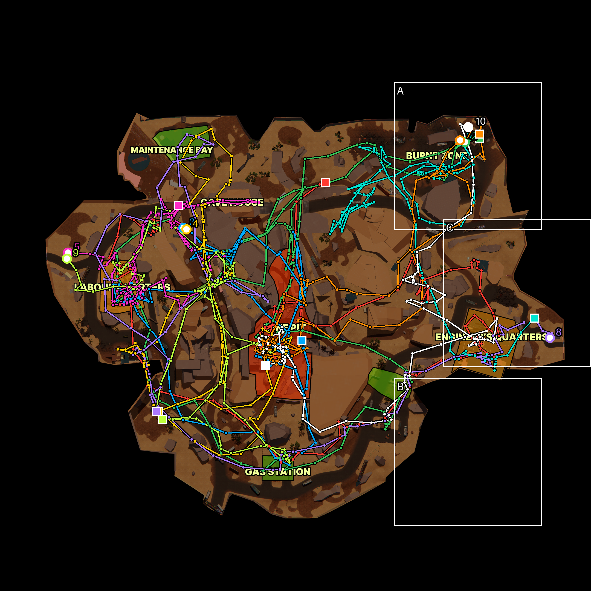 | 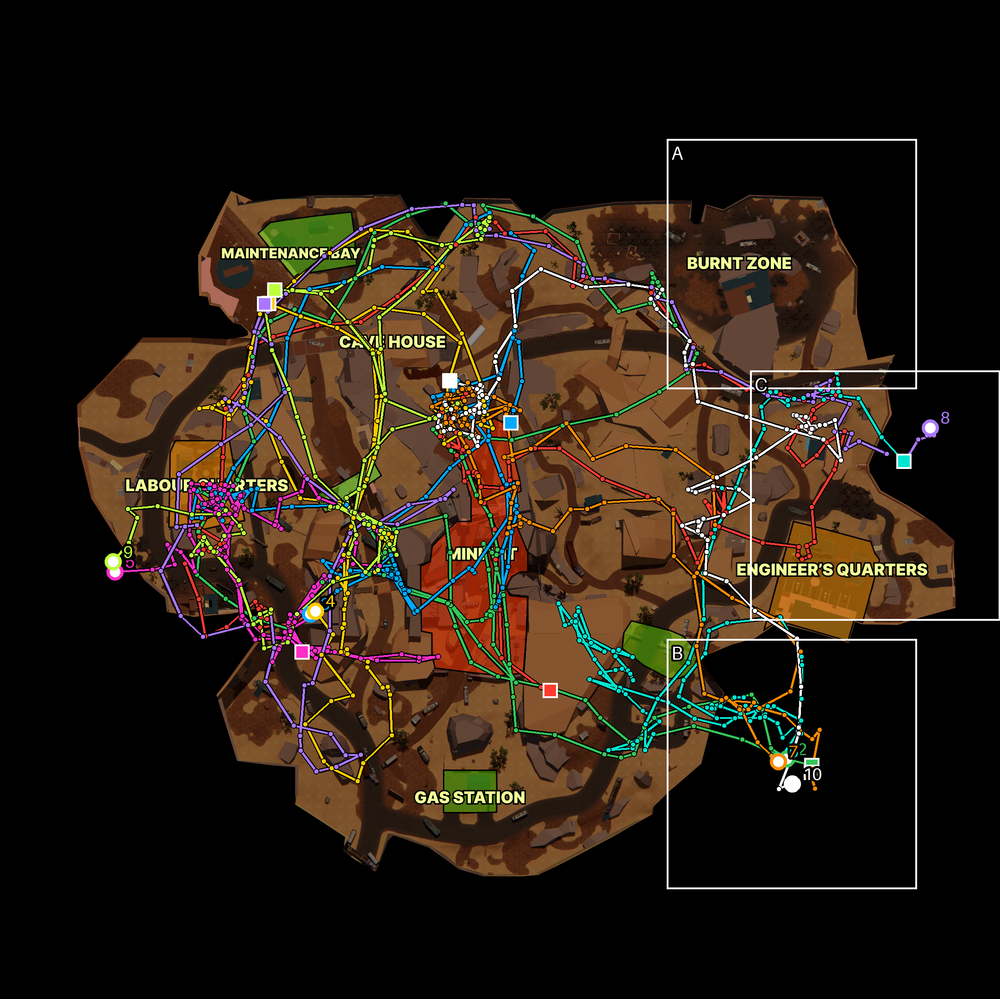 |

*Burnt Zone crop. Journeys 2, 6, 7 and 10 start together on map ground; without the flip the area is empty.*
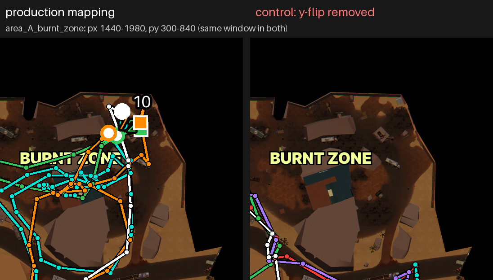

*South-east crop. Without the flip, starts and dense paths sit in the black area outside the map.*
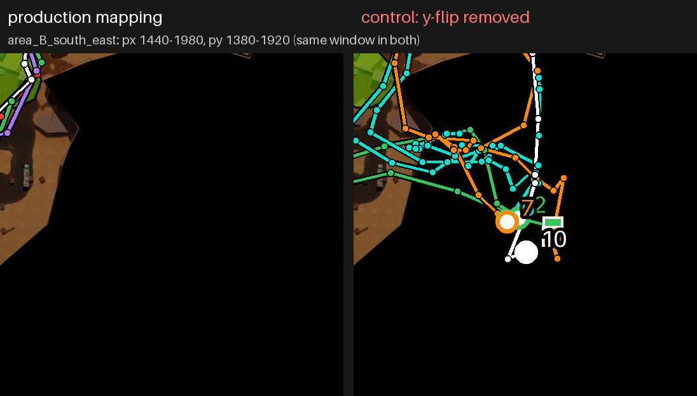

*Engineer's Quarters crop. Journey 8's activity centres on the building; without the flip it shifts north into the void.*
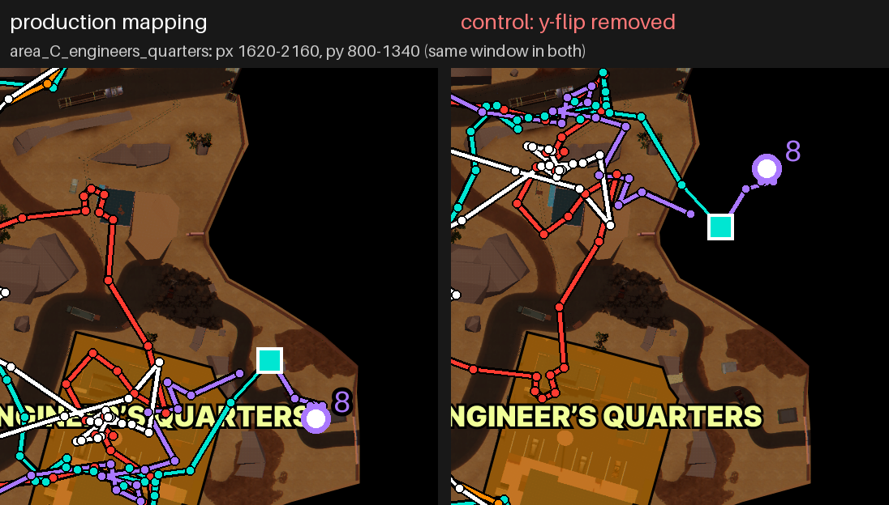

*All three maps: production, no y-flip, and x/z swapped. Only production keeps positions on playable land.*
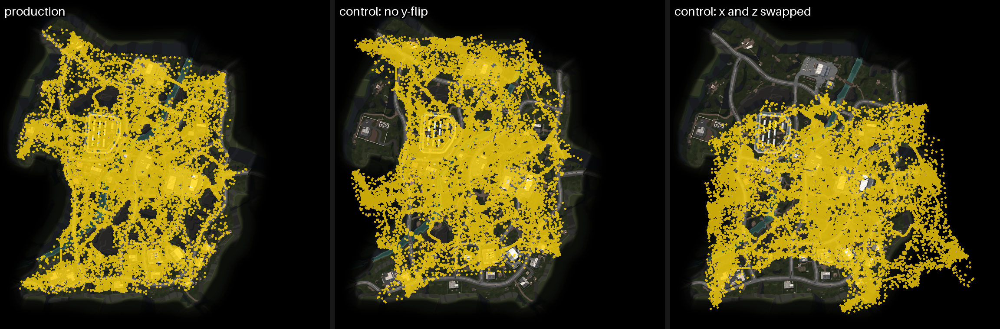
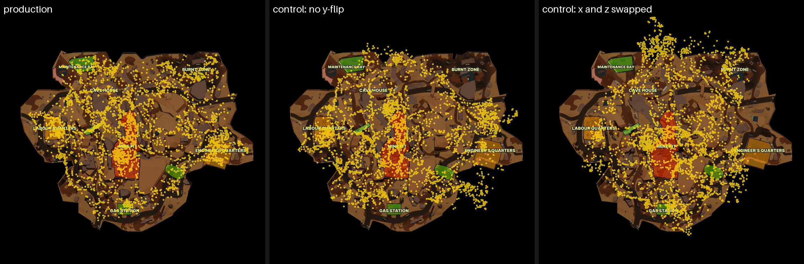
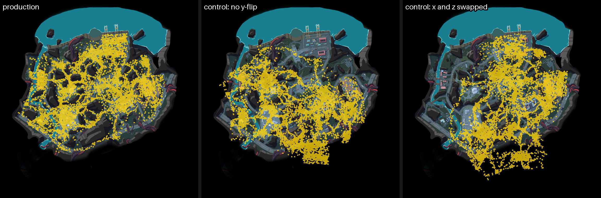

**Limits**
- No landmark ground truth exists, so the mapping is *consistent with* the art rather than *verified*.
- Errors of a few pixels can't be seen.
- GrandRift's 2 px non-square difference (≤ 0.1 % y-stretch) is below what the method can detect.

Sources: [grandrift_validation.md](coordinates/grandrift_validation.md) · [grandrift_metrics.json](coordinates/grandrift_metrics.json) · [reverse_mapping_validation.md](coordinates/reverse_mapping_validation.md) · [RECONCILIATION_EVIDENCE.md §2](../audits/forensic/02_reconciliation/RECONCILIATION_EVIDENCE.md)

## A4. The browser's reverse mapping (hover) is the exact inverse
**Status:** Current. **Assumption:** the pipeline stores UV. The browser converts UV back to world x/z for the hover readout, using each map's own width and height.

**Evidence**
- **Round trip:** all **72,676** exported path points return to their parquet x/z. The maximum error is the 4-decimal rounding limit and nothing more: 0.0636 / 0.0409 / 0.0707 world units on AmbroseValley / GrandRift / Lockdown, at most about 0.29 of a WebP pixel.
- **Pixel probes:** 2,005 per map. The differences are floating-point noise (about 1e-13).
- **Extent:** all 72,996 recorded positions fall inside their map's calibrated square. None is clamped.
- **Proportions:** GrandRift is the only non-square map. Treating it as square would put the south edge 2 px off. The code uses W and H separately.

*Overlays: every exported position (humans yellow, bots blue; white = the 17 journeys then classed `unknown`), a 100-unit world grid and cursor probes labelled with the world x/z the browser returns.*

| AmbroseValley | GrandRift | Lockdown |
|---|---|---|
| 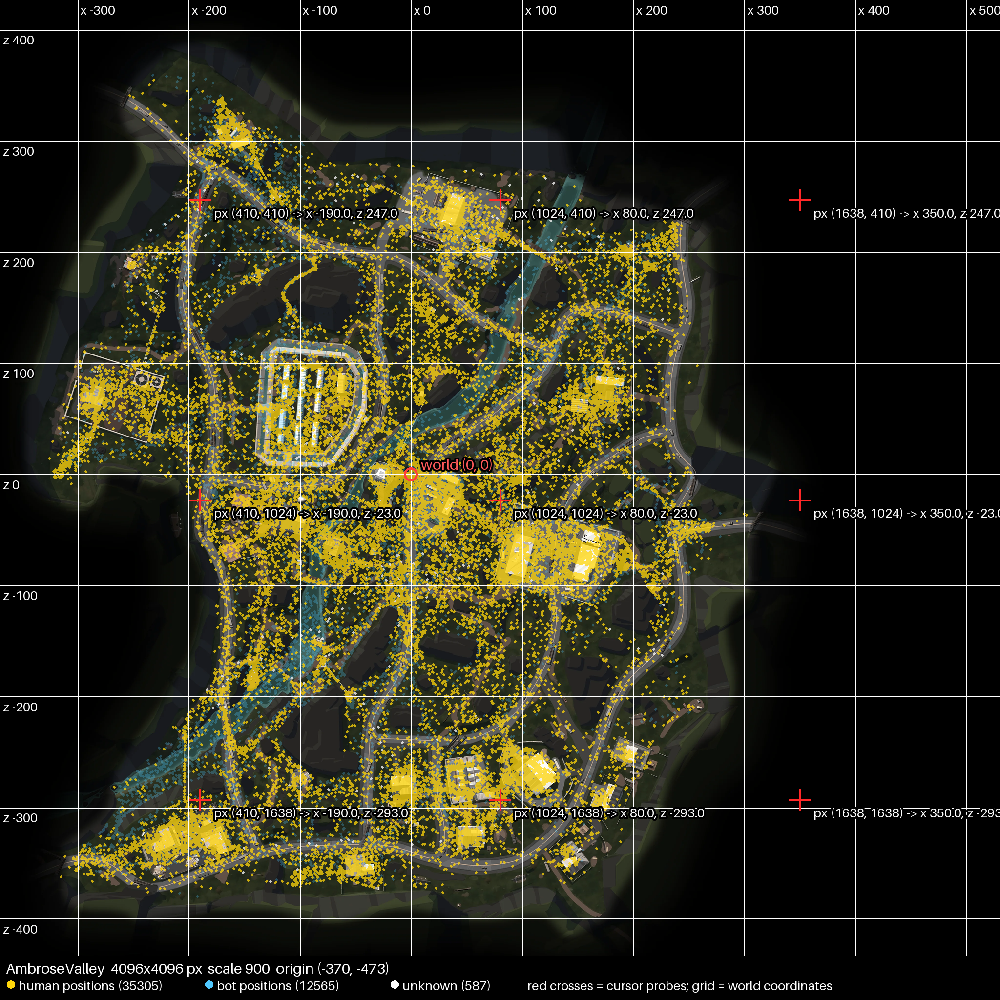 | 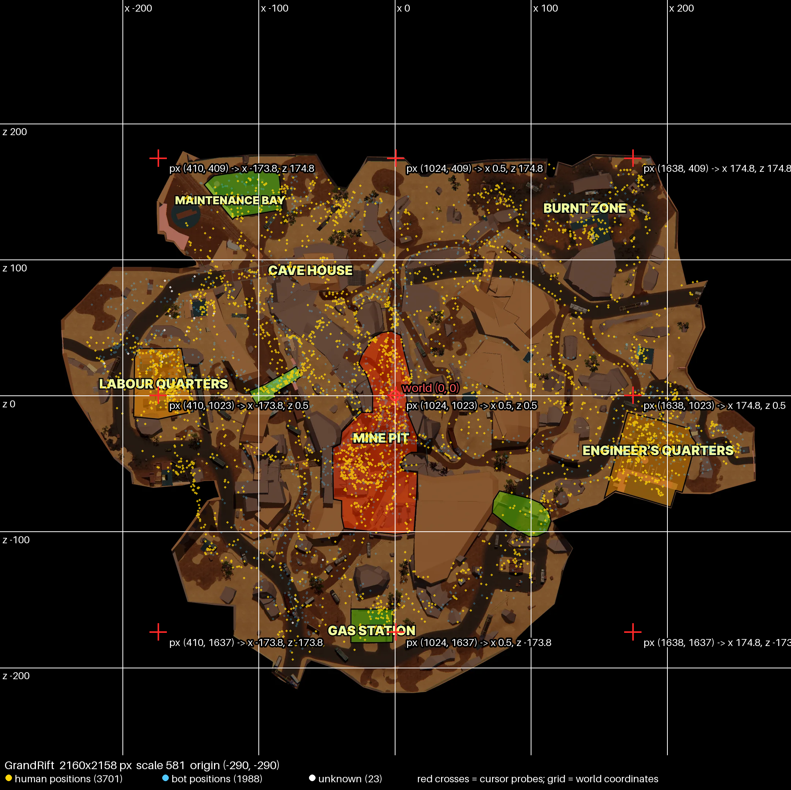 | 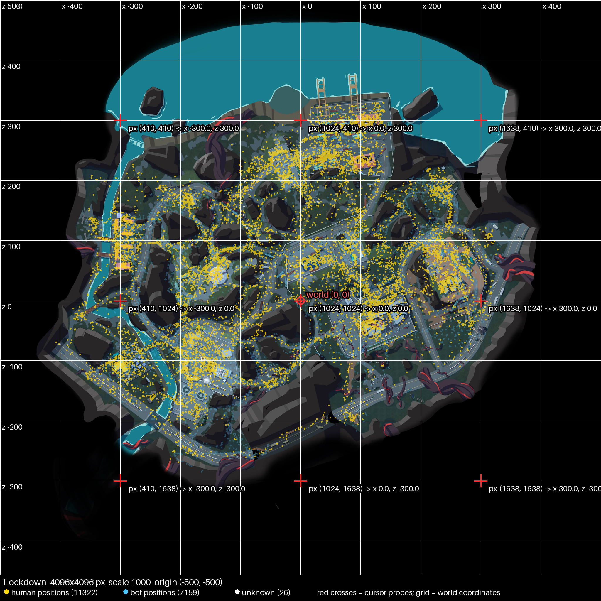 |

**Limit:** deck.gl's `BitmapLayer` placement was not exercised in a running browser.

Sources: [reverse_mapping_validation.md](coordinates/reverse_mapping_validation.md) · [reverse_mapping_metrics.json](coordinates/reverse_mapping_metrics.json)

## A5. Duplicates: one file read once, three doubled journeys halved, nothing else removed
**Status:** Current (decision D3; EC-04, EC-29, EC-06).

**Evidence**
- **One byte-identical file** (same SHA-256) is in both `February_10` and `February_11`. The pipeline reads 1,242 of 1,243 files.
- **Three journeys hold their content twice.** In each, the second half equals the first half on all 8 columns, and `ts` jumps backwards at the midpoint. They have 8, 78 and 294 rows; **190 rows** are removed. Without this, 2 of them would show two deaths each. These are the only files whose rows are out of time order.
- **Identical same-second Loot/BotKill rows are kept (1,227 rows).** Same-second loot continues a smooth pickup-rate curve: 1,273 loot→loot gaps of 0 s, 1,590 of 1 s and 664 of 2 s. Loot rows 1–3 s apart are a median 0.10 units apart.
- **Open uncertainty:** if those rows were logging repeats, loot per journey would fall 7.6–14.5 % (most on GrandRift: 15.37 → 13.14). This can't be decided from the data.
- **Pipeline totals:** 89,016 rows read → 88,826 after un-doubling → 88,653 final.

Sources: [build_report.json](build_report.json) · [INDEPENDENT_EVIDENCE.md §2.2–2.4](../audits/forensic/01_independent/INDEPENDENT_EVIDENCE.md) · [RECONCILIATION_EVIDENCE.md §7.4](../audits/forensic/02_reconciliation/RECONCILIATION_EVIDENCE.md)

## A6. Actors are classified by behaviour, not by ID
**Status:** Current (EC-09; changed 2026-10-24). **Assumption:** a file that logs `BotPosition` is a bot; every other file is human. 17 journeys (3 actors) have numeric "bot" IDs but log `Position`/`Loot`. They count as **human** and stay flagged `id_mismatch`. Totals: **798 human, 444 bot, 0 unknown**.

**Evidence that the 17 come from the player client**

| Event | UUID files (781) | Numeric + `BotPosition` (444) | Numeric, no `BotPosition` (17) |
|---|---|---|---|
| `Position` | 781 | 0 | 17 |
| `BotPosition` | 0 | 444 | 0 |
| `Loot` | 724 | **0** | 14 |
| `KilledByStorm` | 39 | 0 | 0 |

- No file logs both `Position` and `BotPosition`.
- **Speed:** no bot ever exceeds 5.0 units/s, across all 444 bot files. 12 of the 17 do, as do 728 of the 781 UUID journeys.
- **Role in the match:** all 17 start at their match's first event, as every UUID journey does. Only 28 of 444 bot journeys do.

**Evidence against "a person played them"**
- The ID format says bot.
- Actor A (14 of the 17 journeys) is an ordinary bot in 3 other matches.
- Only 1 of the 17 dies, against 442 of 781 UUID journeys. Their median length is 161 s, against 367 s.

**Why "human" was still chosen (S, 2026-10-24)**
- The events say player client, so they are counted.
- The cost: nothing proves a person played them.
- The effect is small. Adding them changed heatmap totals by at most **1.63 %** (AmbroseValley traffic). Every layer kept its top-10 cells, with per-cell correlation ≥ 0.9993.
- Human journeys went 781 → 798, players 245 → 248, and every match now has a human.

| Map | Layer | Share from the 17 | Top-10 cells shared | Pearson r |
|---|---|---|---|---|
| AmbroseValley | kills / deaths / traffic | 0.78 % / 0.32 % / 1.63 % | 10/10 each | ≥ 0.9993 |
| GrandRift | kills / deaths / traffic | 0 % / 0 % / 0.62 % | 10/10 each | ≥ 0.9997 |
| Lockdown | kills / deaths / traffic | 0 % / 0 % / 0.24 % | 10/10 each | ≥ 0.9999 |

Sources: [event_forensics/actor_classification.md](event_forensics/actor_classification.md) (written when the class was `unknown`) · [actor_classification.csv](event_forensics/actor_classification.csv) (regenerated: `final_classification = human`) · [heatmap_impact.md](event_forensics/heatmap_impact.md) · [INDEPENDENT_EVIDENCE.md §3](../audits/forensic/01_independent/INDEPENDENT_EVIDENCE.md)

## A7. An event's position is the file owner's position
**Status:** Current (EC-11). **Assumption:** a kill marker shows where the killer stood, and a death marker shows where the victim fell. The other party's position is never in the row.

**Evidence**
- **1,686 of 2,198** Loot rows that share a second with a Position row have identical x/z (median distance 0).
- **Cross-file pairing:** a human `BotKill` and a bot `BotKilled` within ±2 s sit a median **12.6 units** apart. That is two different owners' positions, not one shared spot.
- **Side finding:** bot files use `BotKill`/`BotKilled` from the bot's own point of view, including **bot-on-bot kills (43 pairs)**. No published output depends on this.

Sources: [INDEPENDENT_EVIDENCE.md §5.1–5.3](../audits/forensic/01_independent/INDEPENDENT_EVIDENCE.md)

## A8. `Kill`/`Killed` pairs: keep both, claim no cause
**Status:** Current (EC-12). **Assumption:** the 3 pairs are kept with their original labels and flagged `kill_killed_pair`. The `Killed` counts as a death; the `Kill` is left out of kill counts. They are never called self-kills.

**Evidence**

| Case | Map | Match time | Same second and same x/y/z | Journey ends | Other recorded files in the match |
|---|---|---|---|---|---|
| P1 | GrandRift | 431 s | yes | 1 s later | 0 |
| P2 | AmbroseValley | 546 s | yes | 2 s later | 0 |
| P3 | AmbroseValley | 639 s | yes | at once | 0 |

**Why "self-kill" isn't supported**
- Identical positions are expected whatever happened (see A7).
- 743 of 796 matches record only one file, so an unrecorded opponent can't be ruled out.
- No row has a victim or killer column.
- The pairs are logged together: no `Kill` occurs without a `Killed` in the same second, while only 2 of 400 `BotKilled` seconds also have a `BotKill`. That points to one incident logged twice. It says nothing about the cause.

Sources: [kill_killed_pairs.md](event_forensics/kill_killed_pairs.md) · [kill_killed_pairs.csv](event_forensics/kill_killed_pairs.csv) · [INDEPENDENT_EVIDENCE.md §5.4](../audits/forensic/01_independent/INDEPENDENT_EVIDENCE.md)

## A9. Positions after a death are dropped
**Status:** Current (D2, EC-14). **Assumption:** playback must not show a dead player moving. Position rows in a later second than the death are dropped. The 2 late `BotKill`s are kept and flagged `after_death`.

**Evidence**
- 173 positions are dropped across 172 journeys; 2 `BotKill`s are flagged.
- Post-death positions move a median **0.10 units** (max 1.65) from the death point, which fits a body or camera settling.
- No file has more than one death once doubling is undone (A5).
- 33 same-second positions after a death remain. The audit calls this negligible.

Sources: [build_report.json](build_report.json) · [INDEPENDENT_EVIDENCE.md §5.7](../audits/forensic/01_independent/INDEPENDENT_EVIDENCE.md) · [RECONCILIATION_EVIDENCE.md §3](../audits/forensic/02_reconciliation/RECONCILIATION_EVIDENCE.md)

## A10. A match's date is the UTC date of its first event
**Status:** Current (D1). **Assumption:** this date is labelled the "observed start date". 2026-02-09 and 2026-02-14 are flagged as boundary and partial dates.

**Evidence**
- Folder date equals the UTC first-event date for 1,232 of 1,243 files. The 11 exceptions start 23:51–23:58 UTC and sit in the next day's folder.
- Matches per date: 02-09: 1 · 02-10: 287 · 02-11: 197 · 02-12: 162 · 02-13: 112 · 02-14: 37.
- Against the folder rule, **4 matches** change date. The audit calls this negligible.

Sources: [build_report.json](build_report.json) · [INDEPENDENT_EVIDENCE.md §4.4](../audits/forensic/01_independent/INDEPENDENT_EVIDENCE.md) · [FORENSIC_AUDIT_REPORT.md B5](../audits/forensic/FORENSIC_AUDIT_REPORT.md)

## A11. Gaps over 30 s break paths, and traffic is traced along the line
**Status:** **Contested** (D5, EC-16, EC-28; audit finding A1). **Assumption:** a gap between samples means where the player went is unknown. So paths break at gaps over 30 s, traffic spreads step time along the A→B line, and longer gaps are dropped.

**What the audit found**
- **Rows come on a fixed 5 s tick.** 99.92 % of human gaps over 6 s are within ±1 s of a multiple of 5.
- **No movement step has zero displacement** (0 of 71,607), so a missing row means the actor wasn't moving.
- **Displacement doesn't grow with gap length.** Human medians: 13.1 units over 5 s, 9.0 over 30–60 s, 6.9 over 2–10 min. Random row loss would make it grow.
- **Events inside gaps sit next to the earlier point A.** For gaps over 30 s: median 0.85 units from A; 94.3 % closer to A than to B; none further than |AB| + 5.

**What this means**
- A gap of *g* seconds is mostly (*g* − 5) s standing near A, not unknown movement.
- The production rule omits **3.9–4.3 %** of human time.
- Some standing-spot cells are under-counted by up to 7–16×.
- Across the plausible models, region magnitudes move ±1–16 %.

**What still holds**
- The overall traffic picture: Spearman 0.983–0.996.
- The **strongest traffic region on each map** is unchanged under all six models.

**Fix direction (not applied; S decides)**
- Put (*g* − 5) s at A, with no cut-off.
- Rename "estimated movement time".

Sources: [FORENSIC_AUDIT_REPORT.md A1](../audits/forensic/FORENSIC_AUDIT_REPORT.md) · [FOLLOWUP_EVIDENCE.md §1](../audits/forensic/03_followup/FOLLOWUP_EVIDENCE.md) · [RECONCILIATION_EVIDENCE.md §7.1](../audits/forensic/02_reconciliation/RECONCILIATION_EVIDENCE.md) · `d01_emission_rule.json`, `d02_allocation_models.json`, `c02_traffic_sensitivity.json`

## A12. Bot journeys are recorded in only some matches
**Status:** Current wording (audit finding C1, corrected in the Decisions table). **Assumption:** say "bot journeys recorded in 6.5 % of matches", never "bots in 6.5 % of matches".

| Matches (of 796) | Count |
|---|---|
| With recorded bot files | **52** (6.5 %) |
| With a human-file event labelled as combat with a bot | **722** (90.7 %) |
| … where a human was killed by a bot | 399 |
| With no evidence either way | 54 |

**Do the labels really point to bots?** In the 52 matches with bot files, a human's bot-combat event pairs with a bot file's matching event in **25 %** of cases. By chance it would be 1.6–3.2 %. Every pairing is with a bot file, and none with another human.

Sources: [FOLLOWUP_EVIDENCE.md §4](../audits/forensic/03_followup/FOLLOWUP_EVIDENCE.md) · `d04_bot_presence.json`

## A13. Rates are per recorded human journey
**Status:** Current (stats wording). **Assumption:** most matches record one player, so rates use "human journeys" as the denominator, not matches.

**Evidence**
- **743 of 796** matches contain exactly one file.
- The README's "10 humans and 40 bots produce 50 files" is **contradicted** for this dataset.
- The frontend check found one label ("kills per match") used for two denominators at two precisions. It was fixed to "kills per human journey" (2.99, matching the stats pages) and "% of human journeys ending in a recorded death" (56.9 %).

Sources: [RECONCILIATION_EVIDENCE.md §1](../audits/forensic/02_reconciliation/RECONCILIATION_EVIDENCE.md) · [frontend_verification/README.md](frontend_verification/README.md)

## A14. Storm deaths stay in the Deaths layer
**Status:** Current (feature 6b). **Assumption:** storm deaths stay in the Deaths layer and their count is shown separately. There is no separate storm layer.

**Evidence**
- 39 storm deaths, all in human files.
- They happen **655–887 s** (median 739 s) into a match: none before minute 10, then 1 / 11 / 17 / 7 / 3 in minutes 10–14.
- They make up 17 of 315 deaths on AmbroseValley, 5 of 30 on GrandRift and 17 of 97 on Lockdown (**17–18 %** of the layer on the two smaller maps).
- Bot-caused deaths peak in minutes 1–3.
- **Note:** CLAUDE.md says "11–15 min", but one storm death is at **10 min 55 s** (audit C4).

Sources: [INDEPENDENT_EVIDENCE.md §5.5](../audits/forensic/01_independent/INDEPENDENT_EVIDENCE.md) · [spatial_analysis/REPORT.md §5](spatial_analysis/REPORT.md)

## A15. Ending alive is not proof of extraction
**Status:** Current. **Assumption:** no extraction event exists, so anything built on "survived" is labelled *inferred*.

**Evidence**
- 339 human journeys end alive.
- Their spans are **86–840 s** (median 512 s), against a median of 286 s for journeys ending in death.
- An 86 s journey argues against reading every one as an extraction.

Sources: [INDEPENDENT_EVIDENCE.md §5.6](../audits/forensic/01_independent/INDEPENDENT_EVIDENCE.md) · [FORENSIC_AUDIT_REPORT.md B4](../audits/forensic/FORENSIC_AUDIT_REPORT.md)

---

## A16. Single 64 × 64 cells aren't stable; 16 × 16 regions are used for hotspots
**Status:** Current. **Assumption:** the 64 × 64 grid is kept as the numbers and the picture. Hotspots are named only at 16 × 16 regions (4 × 4 cells).

**Evidence**
- **Most kill and death cells hold one event.** For deaths, that is 72 % / 93 % / 82 % of occupied cells on AmbroseValley / GrandRift / Lockdown.
- **Split-half test:** the matches are split into two halves, and the test checks whether both halves pick the same strongest cells. For AmbroseValley kills, the top-5 overlap is **0.0** at 64 × 64, **0.6** at 32 × 32 and **0.8** at 16 × 16 (chance 0.0).
- **GrandRift deaths** show no repeatable pattern at any resolution: 0.0 / 0.0 / 0.2, against a chance level of 0.2.
- **External guidance:** a GameAnalytics post asks for "a few hundred samples" per bin. Our strongest 16 × 16 kill zones hold 139 / 19 / 36 events. Kill-vs-death balance maps are not attempted because the data records only one side of each event.

Sources: [spatial_analysis/REPORT.md §0–2](spatial_analysis/REPORT.md) · [spatial_analysis.json](spatial_analysis/spatial_analysis.json) · [external_references.md](spatial_analysis/external_references.md)

## A17. Hotspot rule: ≥ 5 matches, no match over 50 %, at most 6 per layer
**Status:** Current since 2026-10-24. It **supersedes** the earlier "consistent concentration" rule: top decile, ≥ 0.8 stability over 300 resamples, ≥ 3 players, and surviving three half-region grid shifts.

**Why the earlier rule was dropped**
- **It was fragile.** The audit found the only AmbroseValley death hotspot at stability **0.779 [0.767–0.790]**, below its own 0.8 threshold. It was "consistent" in only 39 % of 100 seed runs.
- **The shift check behaved oddly.** It rejected two more stable death regions (0.896 and 0.845) and was the single most consequential rule. Without it, GrandRift would have shown 8 traffic regions instead of 3.
- **The thresholds mattered a lot.** With the top 5 % instead of the top 10 %, almost nothing was left; with the top 15 %, many more passed.

**Before and after** (57 selections)

| Layer | Selections with no hotspot | Hotspots in total | Median share of the layer held by hotspots |
|---|---|---|---|
| Traffic | 6 → 4 | 39 → 89 | 10 % → 24 % |
| Kills | 16 → 9 | 7 → 53 | 9 % → 35 % |
| Deaths | 17 → 13 | 2 → 29 | 9 % → 40 % |

- Every earlier kill and death hotspot is kept, and 34 of 39 traffic hotspots.
- GrandRift deaths still has none: no region reaches 5 matches.
- **What is given up:** stability is no longer measured, so a hotspot can partly reflect where the region grid falls. The ≥ 5 matches and ≤ 50 % rules limit this but don't remove it.

*Earlier rule, in the UI at the time: AmbroseValley kills, 5 consistent regions, region 2 selected.*
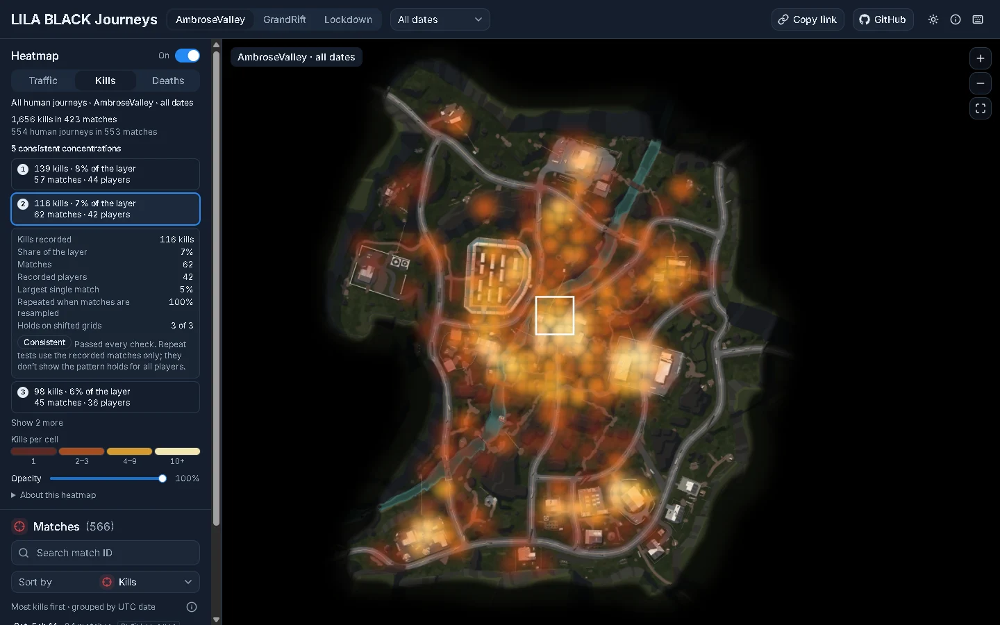

| GrandRift kills: none consistent | Lockdown deaths: 1 consistent | GrandRift traffic: 3 consistent |
|---|---|---|
| 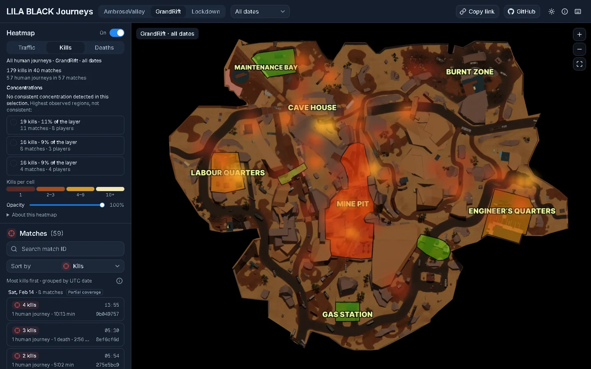 | 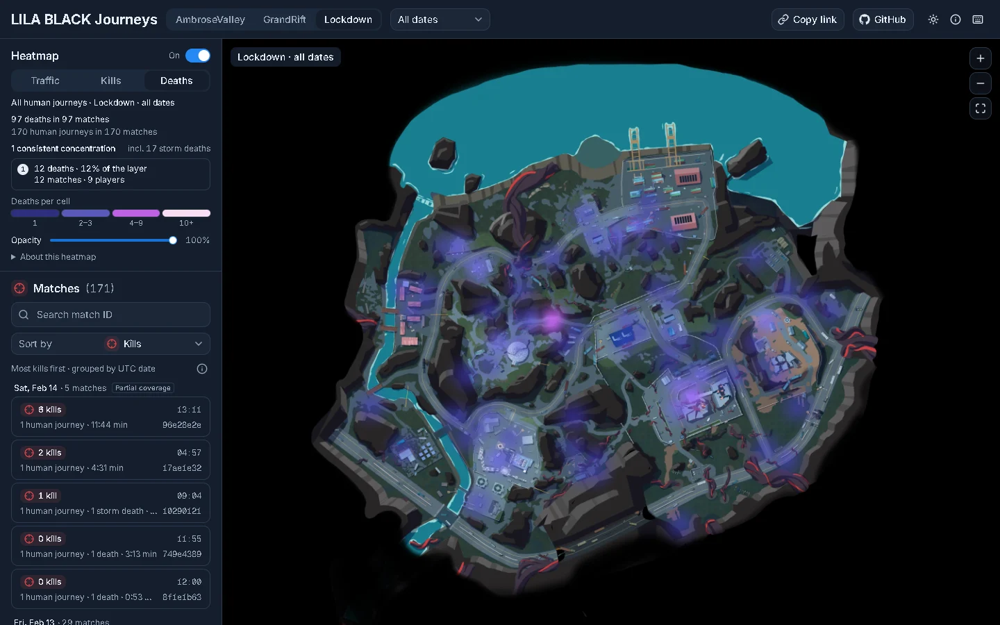 | 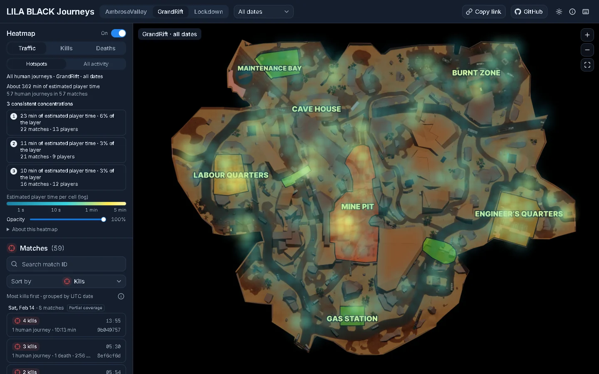 |

*Hotspot outlines (feature 6c): a circle around each region, numbered strongest first.*
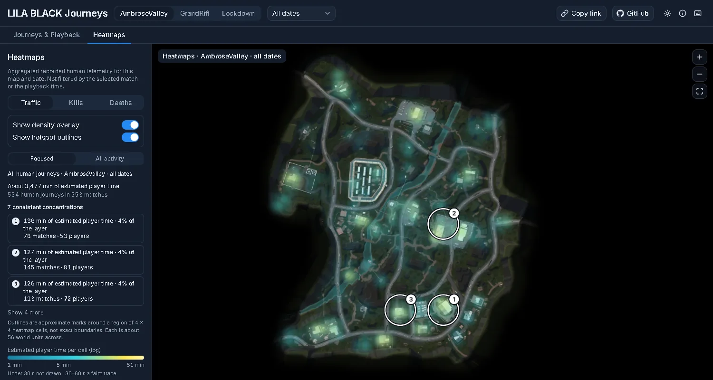

Sources: [hotspot_rules_compare.md](hotspot_rules_compare.md) · [zone_sensitivity.md](spatial_analysis/zone_sensitivity.md) · [spatial_analysis/REPORT.md §3, §8](spatial_analysis/REPORT.md) · [FOLLOWUP_EVIDENCE.md §2](../audits/forensic/03_followup/FOLLOWUP_EVIDENCE.md)

## A18. Kills and deaths are coloured by count classes
**Status:** Current (feature 6b). **Assumption:** 64 × 64 kill and death cells are coloured by absolute count, **1 / 2–3 / 4–9 / 10+**, the same on every map and date. Lightness and opacity rise with the count.

**Evidence**
- **The continuous look didn't separate counts.** Neighbouring counts 1, 2, 4 and 10 were only 4–9 dE apart for kills, and 0 dE for GrandRift deaths (its maximum cell is 2).
- **Hue-only bands fail under colour-vision deficiency.** The same palette cut into bands collapses to 0.9–3.8 dE for kills.
- **Lightness-ordered classes hold up.** They stay ≥ **18.9 dE** apart for kills and ≥ **7.0 dE** for deaths under deuteranopia and protanopia, on every map's typical, darkest and brightest colours.
- **Fixed fractions of the maximum don't work for sparse counts.** 393 of AmbroseValley's 460 kill cells would fall in the bottom band.

*Left: the previous continuous look; middle: the old palette cut into bands; right: the lightness-ordered classes (rows: AmbroseValley kills and deaths, GrandRift kills and deaths).*
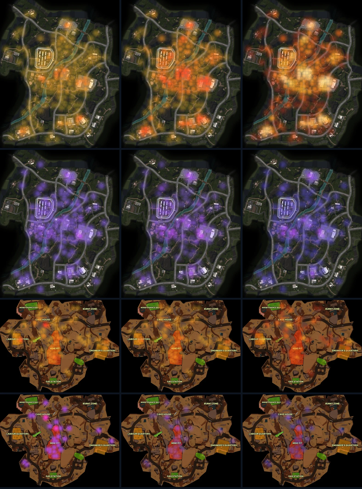

*Continuous glow (left) vs four bands (right).*
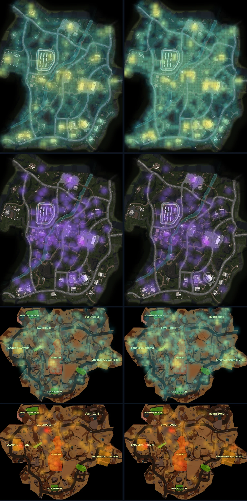

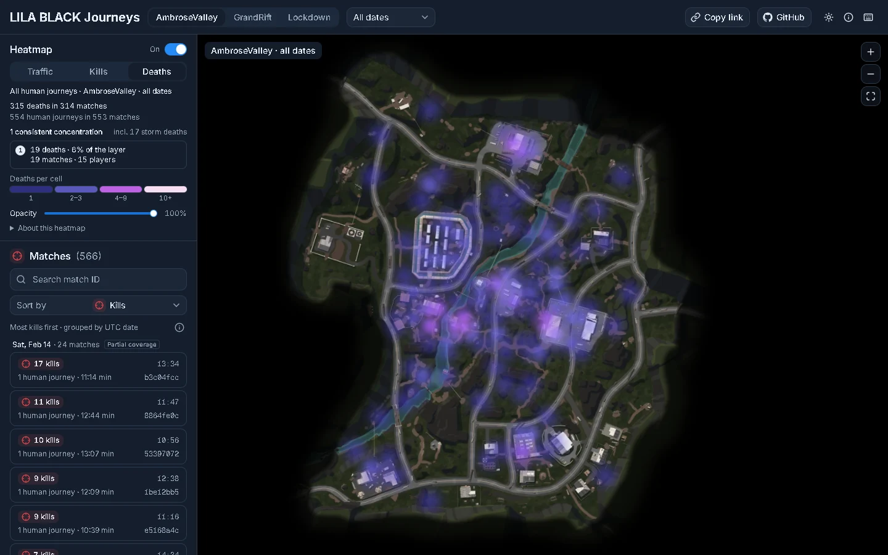

Sources: [spatial_analysis/REPORT.md §4, §7](spatial_analysis/REPORT.md) · [count_bands.json](spatial_analysis/count_bands.json) · [visual_encoding.json](spatial_analysis/visual_encoding.json) · [external_references.md §3](spatial_analysis/external_references.md) (Machado et al. 2009)

## A19. Heatmaps are a painted picture, not a cell mosaic
**Status:** Current (feature 6, visual pass). **Assumption:** each cell is drawn as a soft bump (σ = 1 cell). Opacity follows intensity, and overlapping bumps keep the stronger value without adding up, so no peak is invented. The numbers and the hover stay exact.

**Evidence (before and after screenshots)**
- **Why it read as a mosaic:** traffic covers 40 % of AmbroseValley's cells, and every cell had the same opacity.
- **Deaths looked uniform:** 72 % of AmbroseValley's death cells hold one event, so they were all the same dark square.

| Before | After |
|---|---|
| 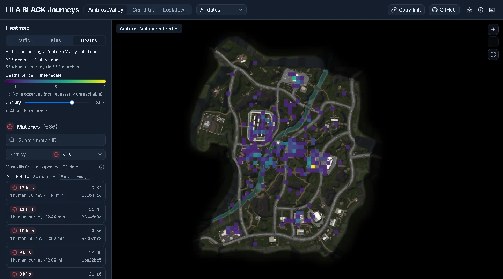 | 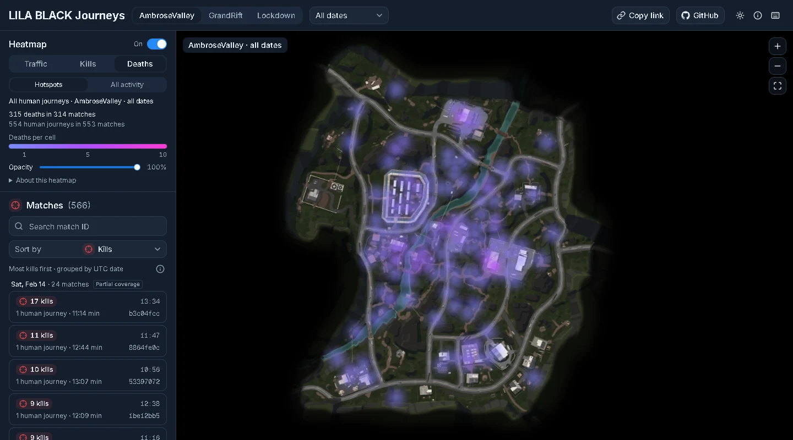 |
| 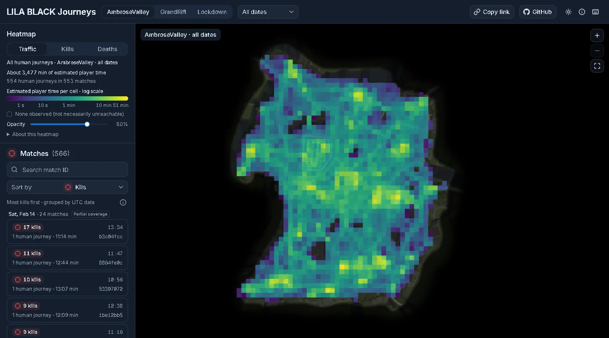 | 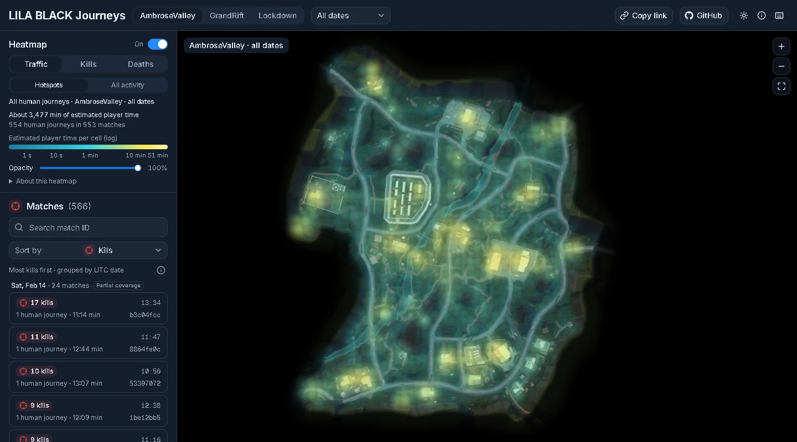 |
| 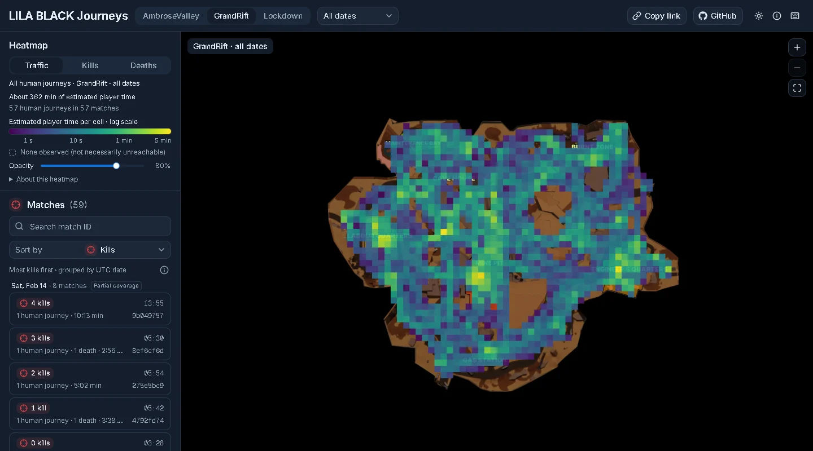 | 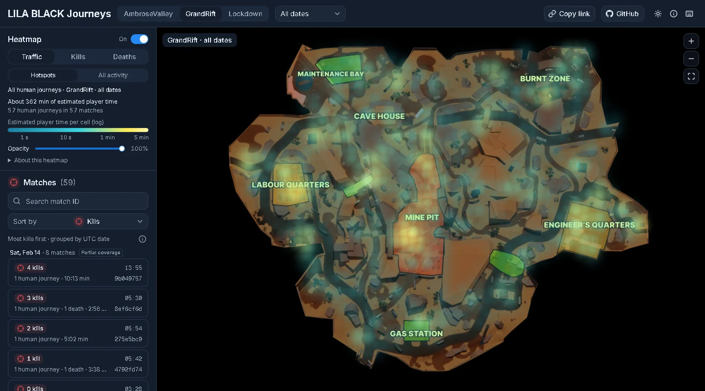 |
| 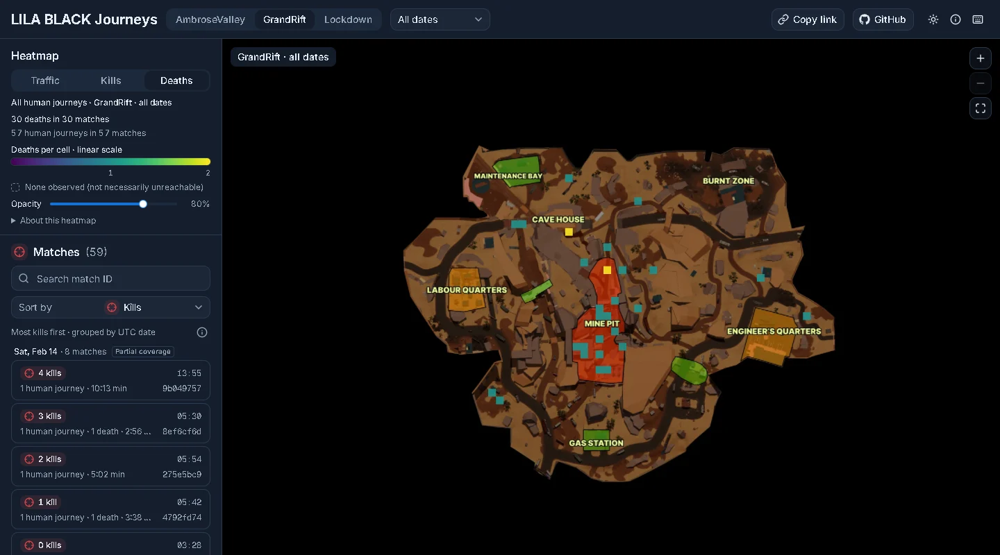 | 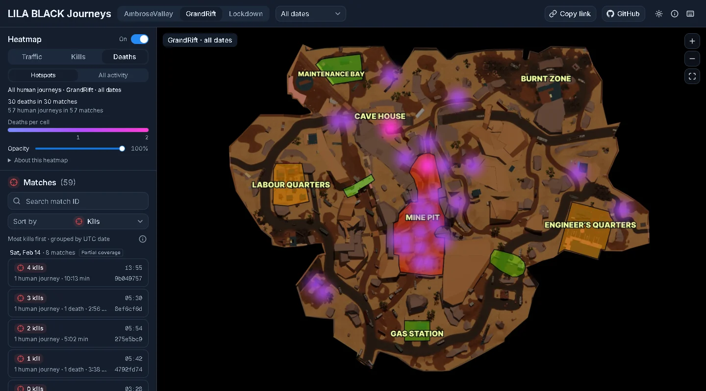 |

Further states are in `heatmap_review/`: GrandRift traffic in All activity, the heatmap switched off, an empty date, a zoomed view, Lockdown deaths on one date, and a match open with the heatmap.

**Note on one date:** an absolute 30 s / 60 s traffic threshold (Focused view) hides **84 %** of GrandRift's cells (31 % of AmbroseValley's). So a single GrandRift day is nearly empty in Focused view, and "All activity" shows everything. This was left open.

Source: `docs/specs/06_HEATMAPS.md` (visual pass) · `heatmap_review/`

---

## A20. The map performance score
**Status:** **Contested** (audit finding B1). **Assumption:** five parts (journeys, median span, kill rate, loot rate, storm-death rate), each min–max scaled and weighted equally, give a relative ranking of the maps.

| Variant | AmbroseValley / GrandRift / Lockdown | Same order in 1,000 bootstraps | AmbroseValley first |
|---|---|---|---|
| Published | 0.76 / 0.49 / 0.25 | 82.2 % | 97.3 % |
| Rank-based | 1.4 / 1.0 / 0.6 | 82.7 % | 97.7 % |
| Without human journeys | 0.71 / 0.61 / 0.25 | 56.5 % | **66.4 %** |

**What the audit found**
- **The order doesn't depend on how parts are scaled.** It does depend on which parts are included.
- **"Human journeys" inflates the stability.** It measures how much a map was played and has no sampling variance.
- **GrandRift overlaps both other maps on every part** at 95 % intervals. For example, its storm deaths per 100 are 8.77 [1.8–17.5].

**Recommendation (S decides):** drop "Leading" / "Needs improvement", or keep the score only as a labelled relative index.

Sources: [FOLLOWUP_EVIDENCE.md §3](../audits/forensic/03_followup/FOLLOWUP_EVIDENCE.md) · `d05_map_score.json` · [RECONCILIATION_EVIDENCE.md §7.3](../audits/forensic/02_reconciliation/RECONCILIATION_EVIDENCE.md)

## A21. The site shows exactly the numbers the pipeline produced
**Status:** Current (verified 2026-10-24).

**Evidence**
- **Data files agree with each other:** **8,011 checks, 0 mismatches**. This covers index ↔ stats ↔ heatmaps ↔ zones ↔ match files.
- **Rendered pages match:** **815 checks, 0 mismatches**, 0 page exceptions. Headless Chrome was run on every map × date, with the expected text computed independently from the JSON.
- **One label defect was found and fixed:** "kills per match" (described in A13).

Sources: [frontend_verification/README.md](frontend_verification/README.md) · `sources_report.json`, `rendered_report.json`

## A22. The pipeline is mathematically correct and reproducible
**Status:** Current.

**Evidence**
- **Every published number was reproduced independently.** All 796 index rows, every match file and every kill and death grid match cell by cell. All **7,792 of 7,792** values in `stats.json` match, and a negative control caught the planted errors.
- **A rebuild is byte-identical,** WebP files included.
- **All 125 tests pass.** Most data expectations in them are counts taken from the same data. They catch regressions, not wrong assumptions; the audit's independent counts are the external check.

Sources: [FORENSIC_AUDIT_REPORT.md](../audits/forensic/FORENSIC_AUDIT_REPORT.md) · [RECONCILIATION_EVIDENCE.md §4–6](../audits/forensic/02_reconciliation/RECONCILIATION_EVIDENCE.md) · [MANIFEST.md](../audits/forensic/MANIFEST.md)

---

## Appendix A. Open points from the audit
Status as recorded in the audit, compared with today's CLAUDE.md.

| ID | Point | Status now |
|---|---|---|
| A1 | Traffic mis-places standing time and omits 3.9–4.3 % of it | Open (A11) |
| A2 | AmbroseValley death hotspot failed its own stability rule | Moot: the stability rule was replaced (A17) |
| B1 | Map score isn't a quality measure | Open (A20) |
| B2 | Identical same-second loot rows: loot rate uncertain by 7.6–14.5 % | Open (A5) |
| C1 | "Bots in 6.5 % of matches" wording | Fixed in the Decisions table (A12) |
| C2 | Spec 02 point 15 says "355, shortest 25 s"; should be 339 and 86 s | Check spec 02 |
| C3 | EC-20 "alpha 255 on every pixel": 1,194 AmbroseValley pixels are below 255 | Check EC-20 (immaterial) |
| C4 | "Storm deaths 11–15 min" (one at 10:55); "gaps up to 8 min" (human max 5 min; 8.6 min is a bot gap) | Still in the CLAUDE.md Data facts |
| C6 | `map_score` rounds before scaling (≤ 0.0003) | Open, negligible |
| C8 | `INSIGHTS.md` stale | Check |
| C9 | README says `make data` takes ~45 s; it took 127 s | Check README |

## Appendix B. Index of every evidence file
| Folder / file | What it is |
|---|---|
| `build_report.json` | Pipeline counts: files, rows, duplicates, doubled journeys, actors, dates |
| `coordinates/grandrift_validation.md`, `grandrift_metrics.json`, `grandrift_*.png` | Forward-mapping check on GrandRift with a no-flip control (A3) |
| `coordinates/reverse_mapping_validation.md`, `reverse_mapping_metrics.json`, `reverse_*.png` | Reverse (hover) mapping on all three maps (A3, A4) |
| `event_forensics/` | Actor classes (A6), Kill/Killed pairs (A8), heatmap impact |
| `spatial_analysis/` | Sparsity, stability, resolution, colour encoding, count bands, external references (A16–A18) |
| `hotspot_rules_compare.md` | Old vs new hotspot rule (A17) |
| `screenshots/heatmap_review/` | Before and after screenshots of the heatmap visual pass (A19) |
| `screenshots/interpretation_layer/` | Screenshots of the earlier hotspot layer (A17, A18) |
| `screenshots/tabs_and_outlines/` | Screenshots of the tabs, density and outline switches, and click-to-zoom (13 images) |
| [`../audits/forensic/`](../audits/forensic/FORENSIC_AUDIT_REPORT.md) (moved out of evidence) | Independent audit: Part 1 independent, Part 2 reconciliation, Part 3 follow-up, plus scripts (A1, A11, A12, A20, A22) |
| `frontend_verification/` | Data files ↔ rendered pages check (A21) |
